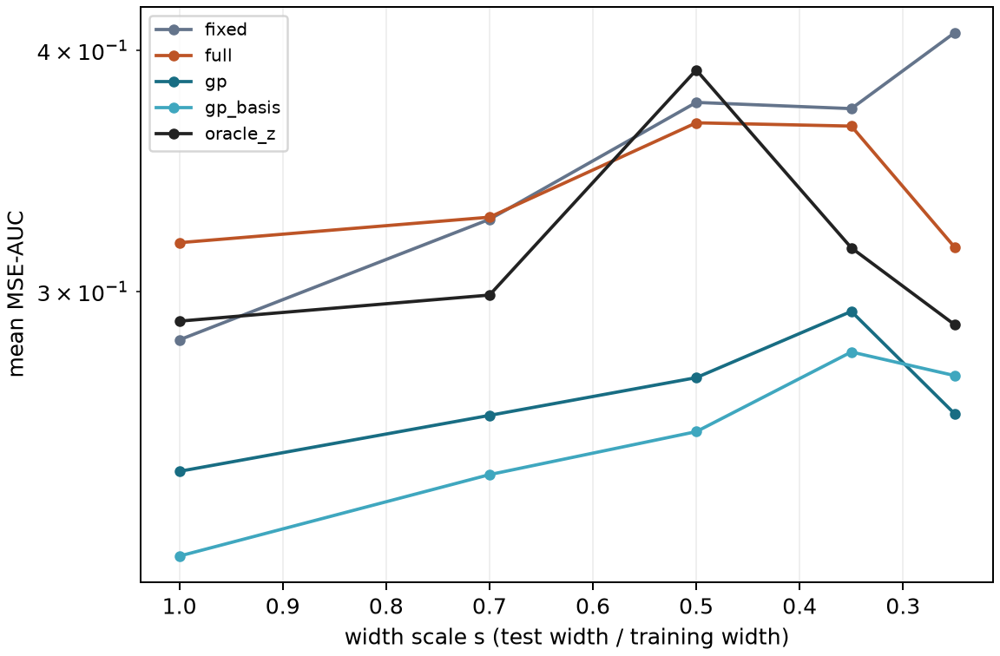

# Feature Geometry for Active Regression

Learning a response curve from a few measurements requires two decisions: how to adapt what is already known, and where to measure next. In a frequency sweep, for example, a new mechanical configuration may move or sharpen a resonance. A representation learned from previous configurations can help, but its useful features may be in the wrong places.

This project studies Bayesian regression with a small number of task-specific feature coordinates. A shared model learns the locations and widths of tanh features across functions. A new task adapts four geometric coordinates, integrates the linear readout analytically, and uses the resulting uncertainty to choose its next observation. The implementation connects probabilistic modeling, differentiable meta-learning, active experimental design, and controlled numerical experiments.

The research question is concrete: **when does adapting a feature span improve prediction more than estimating a readout on the existing span?** The repository includes the model, mathematical diagnostics, a five-seed mechanism study, and the complete numerical record.



## The regression problem

Each task is an unknown function on `[-1, 1]`. An observation reveals its value at one selected input, with additive Gaussian noise. The predictor starts from a small context and purchases additional observations from a finite pool. It is evaluated on separate, unqueried inputs.

The objective is low integrated squared error for the latent function throughout the observation budget. Query-averaged MSE measures the whole learning curve; interval coverage and fitting time describe uncertainty and computational cost. This matters because a method that improves its final prediction may still make worse decisions during the earlier, more constrained stages.

Two simulators provide known ground truth: pulse functions with controlled locations and widths, and complex frequency responses from an eight-mass damped chain. Entire functions form the training, validation, and test splits. The chain adds coupled real and imaginary outputs and an independently checked numerical reference.

## From a feature model to a predictive distribution

For a latent vector `z`, the representation is

```text
phi(x; z) = [1, x, tanh((x - c_j(z)) / ell_j(z))] / sqrt(h + 2)
f(x) = phi(x; z) w
```

Two latent coordinates move the centers; two change log widths. Shared parameters include the base geometry, normalized latent loadings, readout prior, and latent prior. This parameterization restricts adaptation to interpretable changes while allowing the readout to describe each function's amplitudes and background.

Conditional on `z`, the model is Bayesian linear regression. With feature matrix `Phi`, Gaussian prior `N(m0, S0)`, and noise variance `sigma²`, its readout update is

```text
S_C = (S0⁻¹ + Phiᵀ Phi / sigma²)⁻¹
m_C = S_C (S0⁻¹ m0 + Phiᵀ y / sigma²).
```

[The Gaussian routines](src/geometa/blr.py) use Cholesky factorizations for the posterior and marginal likelihood. Integrating out the readout leaves a low-dimensional inference problem for `z`. [Variational adaptation](src/geometa/inference.py) optimizes a diagonal Gaussian using the collapsed likelihood and a Gaussian KL term.

[Meta-training](src/geometa/training.py) differentiates through these context updates. Its outer loss is the joint predictive negative log likelihood of a separate query set, approximated by a finite mixture over latent states. Keeping the query likelihood joint preserves dependencies between predictions at different locations.

The predictive covariance then follows the law of total covariance:

```text
Cov(f | context) = E_z[Cov(f | z, context)]
                  + Cov_z(E[f | z, context]).
```

Both terms are retained. The first represents uncertainty in the readout; the second represents disagreement between geometries. Shared geometry also couples the real and imaginary response components. The [research design walkthrough](docs/research-design.md) derives the inference and explains the implementation choices.

## Choosing the next measurement

[Acquisition](src/geometa/acquisition.py) scores an observation by its expected reduction in average latent variance on an integration grid. Two implementations expose the approximation being made.

Moment-matched acquisition uses the covariance of the Gaussian matching the current posterior's first two moments. Fantasy acquisition instead simulates possible observations, conditions each Gaussian component, and updates the component probabilities before recomputing uncertainty. A measurement can therefore help by resolving which geometry is plausible, as well as refining a readout.

Candidate observations include measurement noise; the integrated target remains the noiseless function. Uniform exploration supplements the acquisition rule. Query noise is keyed to task and location, so competing methods receive the same noise when they request the same measurement.

## Experiments that distinguish the mechanisms

The [controlled sweep](configs/sweep.yaml) changes one generator variable at a time: translation beyond the training range, measured in units of peak width, or width relative to the training distribution. Five training seeds and 12 tasks per group and seed produce 720 held-out functions. Fifteen settings evaluated at eight budgets yield 86,400 metric records.

The comparisons answer different questions:

- `fixed`, `position`, `width`, and `full` share a checkpoint, isolating which task-level geometric changes help.
- `point`, `full_cheap`, and `full_rich` separate posterior averaging from inference budget. `linearized` tests a local Gaussian update around the context-conditioned readout.
- A trained two-scale Matérn GP supplies a different inductive bias. `gp_basis` adds the learned fixed basis to its residual process, separating access to that basis from geometric adaptation.
- Random-query versions of the same predictors separate query selection from predictive modeling.

Two [mathematical diagnostics](docs/theory.md) guide these comparisons: a Taylor remainder for a translated tanh feature, and a projection bound on the error outside a fixed feature span. Ten predictions and scoring rules were recorded in [PREDICTIONS.md](PREDICTIONS.md) before the sweep. Truth-fitted geometry is evaluated separately as a diagnostic, with no role in ordinary prediction or acquisition.

## What the recorded sweep shows

| Width scale | Fixed features | Geometric posterior | Linearized adaptation | Matérn GP |
|---|---:|---:|---:|---:|
| 1.00 | 0.283 | 0.318 | 0.271 | 0.242 |
| 0.70 | 0.327 | 0.328 | 0.314 | 0.259 |
| 0.50 | 0.376 | 0.367 | 0.351 | 0.271 |
| 0.35 | 0.373 | 0.365 | 0.356 | 0.293 |
| 0.25 | 0.408 | 0.316 | 0.288 | 0.259 |

Values are mean query-averaged normalized MSE over 3–10 observations; lower is better. Each row contains 60 tasks. Adaptation improves on fixed features most clearly in the narrowest group, while the GP achieves lower mean error across these width settings.

The representation diagnostics help explain this pattern. Across translation groups, the fixed-span residual is only 0.6%–16.8% of the fixed model's final-budget MSE at 10 observations. At width scale 0.25 that ratio rises to 26.6%. These ratios use endpoint MSE, rather than the query-averaged AUC in the table. Much of the translation error therefore remains an estimation problem even when the representation can express the function.

Active queries improve mean AUC over random queries by 0.1165 for the full posterior and 0.1470 for fixed features across translation groups. Uncertainty is evaluated separately: nominal 95% pointwise coverage is 0.63–0.74 before validation-selected inflation and 0.82–0.89 afterward. [Complete results](docs/results.md) retain all groups, comparisons, and the hypothesis scorecard. Paired task-bootstrap intervals describe task variation; they do not resample training seeds.

## Numerical checks and reproducibility

The 15 tests check mathematical and experimental properties, including ridge/BLR equivalence, collapsed-likelihood gradients, total covariance, coherent function sampling, and Gaussian versus mixture acquisition. A two-component test checks that an informative observation changes mixture probabilities. Meta-gradient tests verify that all seven shared parameter groups receive finite, nonzero gradients. Split and oracle tests check training-only normalization, common observation noise, and agreement between modal and direct mechanical solvers.

The [mathematical tests](tests/test_math.py), [data and training tests](tests/test_data_and_inference.py), and [mechanism tests](tests/test_mechanism.py) provide executable entry points to these checks. Recorded runs include configurations, split IDs, source hashes, training summaries, compressed metrics, and figures.

```bash
python -m pip install -e '.[test]'
python -m pytest -q
geometa --config configs/smoke.yaml --output outputs/smoke
geometa --config configs/sweep.yaml --output outputs/sweep
python scripts/analyze_mechanism.py outputs/sweep
python scripts/inspect_run.py outputs/sweep
```

Python 3.10+ is required; these experiments run on CPU. Use a fresh output directory for each run. The [reproduction guide](docs/reproduction.md) also explains how to reanalyze the recorded metrics without retraining. For measurement-driven use, [ActiveRegressor](src/geometa/api.py) exposes `observe`, `predict`, and `suggest`; [the API example](scripts/api_example.py) runs against a generated checkpoint.
