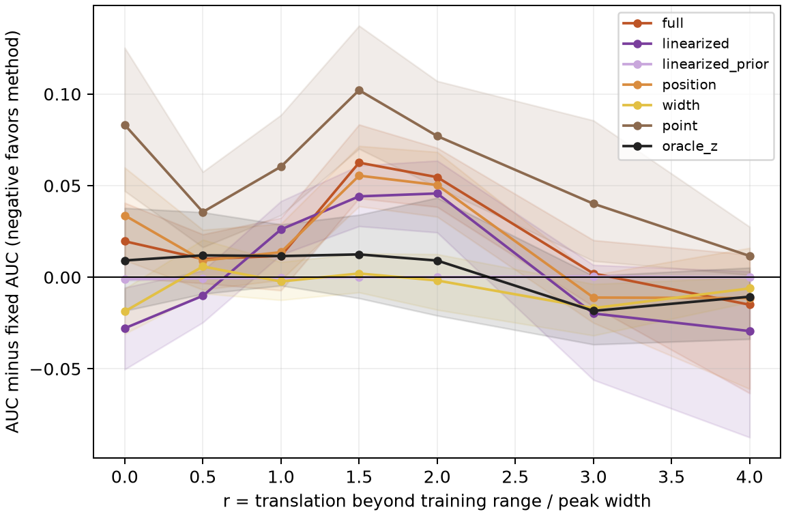
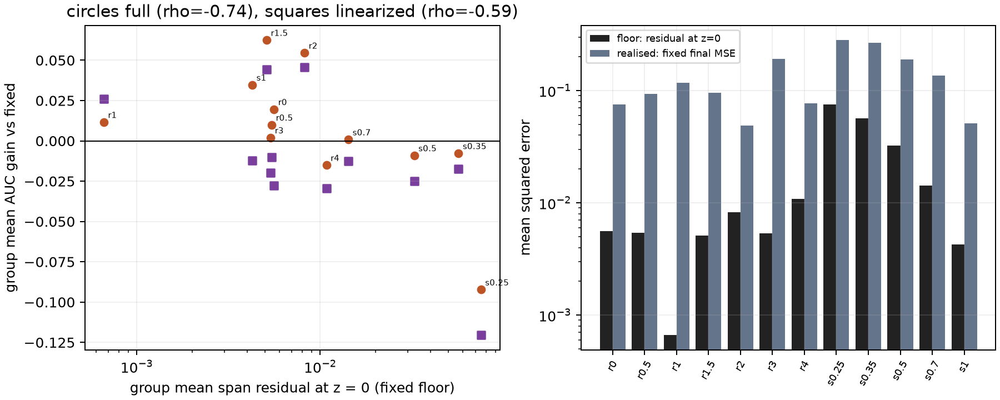
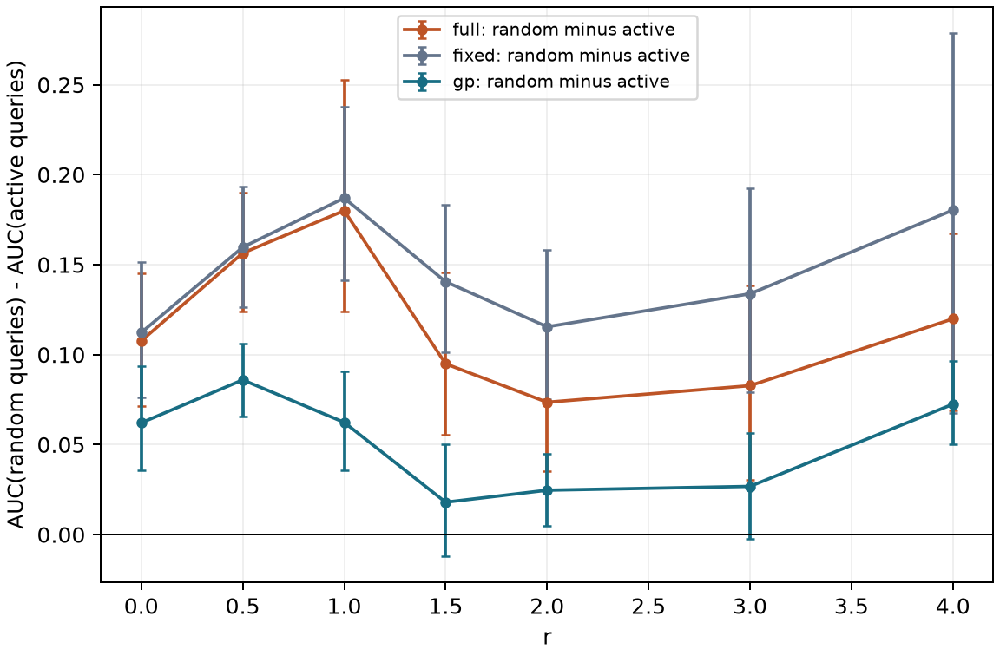

# Controlled sweep results

The sweep uses five shared-training seeds and 12 held-out tasks per group and seed. Each of the 12 groups therefore contains 60 tasks. The metric is query-averaged normalized latent MSE over budgets 3 through 10; lower is better. All functions are synthetic.

| Group | Fixed | Full | Linearized | GP | GP with basis |
|---|---:|---:|---:|---:|---:|
| shift_r0 | 0.3751 | 0.3947 | 0.3472 | 0.2623 | 0.2581 |
| shift_r0.5 | 0.2893 | 0.2993 | 0.2792 | 0.2073 | 0.2189 |
| shift_r1 | 0.3452 | 0.3568 | 0.3712 | 0.2496 | 0.3097 |
| shift_r1.5 | 0.3686 | 0.4311 | 0.4127 | 0.2893 | 0.3872 |
| shift_r2 | 0.3742 | 0.4288 | 0.4199 | 0.3049 | 0.4173 |
| shift_r3 | 0.3945 | 0.3965 | 0.3747 | 0.3165 | 0.3976 |
| shift_r4 | 0.1609 | 0.1459 | 0.1315 | 0.1026 | 0.1118 |
| width_s0.25 | 0.4085 | 0.3162 | 0.2879 | 0.2593 | 0.2714 |
| width_s0.35 | 0.3731 | 0.3654 | 0.3557 | 0.2930 | 0.2791 |
| width_s0.5 | 0.3759 | 0.3668 | 0.3510 | 0.2707 | 0.2538 |
| width_s0.7 | 0.3270 | 0.3278 | 0.3143 | 0.2588 | 0.2411 |
| width_s1 | 0.2832 | 0.3180 | 0.2708 | 0.2421 | 0.2188 |

The fixed-feature comparison isolates the effect of task adaptation using the same learned checkpoint. The GP has its own kernel fitted on the same training tasks. The [all-method table](../results/sweep-20260924/mechanism/tables/group_mean_auc.csv) contains all 15 settings; [paired differences](../results/sweep-20260924/mechanism/tables/gain_vs_fixed.csv) give task-bootstrap intervals. These intervals do not resample shared-training seeds.

## Representation and estimation

The fixed-span residual is a lower bound for any readout on that span, but it is often much smaller than the error obtained from three to ten observations. Across translation groups the group-mean floor is 0.6% to 16.8% of realized fixed-feature error. In the narrowest width group it rises to 26.6%, where adaptation has a clearer advantage over fixed features.

Task-level Spearman correlations are 0.180 between fixed-span residual and fixed-model AUC, and -0.140 between residual reduction and adaptation gain. The exploratory group-level correlation is -0.74. The distinction between task-level and group-level analysis matters when interpreting the representation diagnostic.

## Queries and uncertainty

Across translation groups, active queries improve mean AUC over random queries by 0.1165 for the full posterior and 0.1470 for fixed features. Nominal 95% pointwise coverage for the full posterior ranges from 0.63 to 0.74; validation-selected interval inflation raises it to 0.82–0.89. Increasing the inference budget alone does not improve coverage in this sweep.

The ten predictions and their decision rules are in [PREDICTIONS.md](../PREDICTIONS.md). The complete [recorded scorecard](../results/sweep-20260924/mechanism/scorecard.md) is retained with its measured inputs. The diagnostic recovery ratios in H5 use an epsilon-clamped denominator when the proposed oracle ordering fails; those large ratios are undefined as measures of recovered gain and should not be interpreted numerically.

## Earlier pulse-and-chain experiment

The [earlier run](../results/local-final-20260911/) evaluates five pulse and chain groups. It uses two seeds and six tasks per group. Its `linearized` label refers to the prior-mean expansion now named `linearized_prior`; the current sweep uses the conditional-mean expansion. The two records are kept separately.
